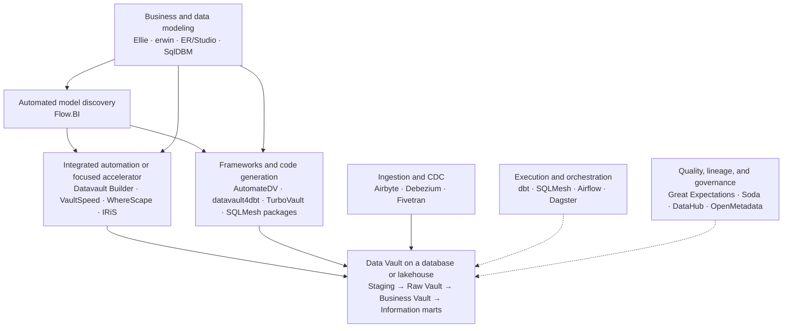

# Data Vault Tools Landscape

A curated landscape of tools for designing, generating, loading, testing, and operating Data Vault data platforms.

**Research snapshot: 5 November 2026.** Includes commercial products, open-source frameworks, community utilities, and selected supporting technologies. Entries are grouped by their principal role and alphabetized within each table. Placement is an editorial classification, not a ranking.

## Contents

- [Landscape at a glance](#landscape-at-a-glance)
- [Scope and evidence](#scope-and-evidence)
- [Automation platforms and accelerators](#automation-platforms-and-accelerators)
- [Frameworks, packages, and code generators](#frameworks-packages-and-code-generators)
- [Modeling and design](#modeling-and-design)
- [Supporting delivery stack](#supporting-delivery-stack)
- [Execution platforms](#execution-platforms)
- [Historical tools and naming changes](#historical-tools-and-naming-changes)
- [How to compare tools](#how-to-compare-tools)
- [Contributing](#contributing)
- [Further landscape resources](#further-landscape-resources)

## Landscape at a glance

| Layer | What it contributes | Representative tools |
| --- | --- | --- |
| Business and data modeling | Business concepts, keys, relationships, physical schemas | Ellie, erwin Data Modeler, ER/Studio, Hackolade, SqlDBM |
| Automated model discovery | Source profiling, business-key identification, relationship discovery, and logical vault derivation | Flow.BI |
| Integrated automation | Model-driven generation, deployment, metadata, and varying operational coverage | Agile Data Engine, beVault, biGENIUS-X, Datavault Builder, DSharp, VaultSpeed, WhereScape |
| Focused accelerators | Data Vault code generation, migration, or integration with an existing stack | IRiS, IRI Voracity, erwin Data Vault Automation, crossnative DVG |
| Frameworks and packages | Reusable loading patterns and metadata-to-code generation | AutomateDV, datavault4dbt, datavault4sqlmesh, diepvries, TurboVault Engine |
| Delivery and operations | Ingestion, change data capture, transformation execution, scheduling, quality, lineage, and deployment | dbt, Debezium, Fivetran, Airflow, Dagster, Great Expectations, DataHub, Flyway |
| Execution and storage | Databases, warehouses, and lakehouses that store and process the vault | Snowflake, Databricks, Microsoft Fabric, BigQuery, Redshift, SQL Server, PostgreSQL |

The layers can overlap: one platform may cover several, while a package may cover only SQL generation. A package, its generator, its execution engine, and its database are separate components of a stack.



*The diagram shows functional roles and alternative delivery approaches; arrows do not assert a specific product integration.*

## Scope and evidence

**Data Vault** here means the analytical data warehousing method associated with hubs, links, satellites, historical integration, and Raw/Business Vault patterns. Products using “vault” for secrets, backups, personal data stores, or unrelated synthetic-data research are outside scope.

Two inclusion levels keep the landscape useful:

- **Direct:** the product or project explicitly documents Data Vault functionality, loading patterns, generation, or modeling integration.
- **Supporting:** a general-purpose technology that can contribute to a Data Vault implementation. Inclusion describes its architectural role; it does not imply built-in Data Vault loading logic, endorsement, or certification.

Product and repository links in each entry are the primary evidence for the description. Descriptions summarize published capabilities; the tools have not been installed or benchmarked for this landscape. An accessible website or repository establishes a documented offering, not a maintenance or support guarantee. Examples of target platforms are illustrative, not compatibility matrices: verify the exact product edition, adapter, package version, and required object types.

Commercial terms and platform coverage change. Prices, customer counts, speed claims, star counts, and certification badges are deliberately omitted. Where a source uses a methodology version such as 2.0 or 2.1, that wording does not establish feature parity with another product.

## Automation platforms and accelerators

These offerings explicitly document Data Vault capabilities. Coverage ranges from integrated warehouse lifecycle automation to focused generation and migration. Commercial unless noted otherwise.

| Tool / provider | Role and documented Data Vault contribution | Dependencies and scope to verify | Primary evidence |
| --- | --- | --- | --- |
| **Agile Data Engine** | Cloud data platform automation with Data Vault modeling, SQL generation, dependency management, deployment, and lineage. | Published targets include Databricks, Snowflake, Microsoft Fabric, and BigQuery; check object coverage per target. | [Data Vault automation](https://www.agiledataengine.com/data-vault-automation) |
| **Agnostic Data Labs — ADL** | Metadata management and template-driven generation, including Data Vault, persistent staging, documentation, and deployment outputs. | Public preview; site describes free access. Generation depends on templates and configuration. Successor to TEAM/VDW; free access does not mean open source. | [Product](https://agnosticdatalabs.com/), [reference configurations](https://agnosticdatalabs.com/why/truly-generic) |
| **AnalyticsCreator** | Microsoft-focused model-driven automation with Data Vault wizards, hub/link/satellite objects, historization, and dimensional output. | Check the required SQL Server, Azure, or Fabric generation path and the artifacts included. | [Data Vault solution](https://www.analyticscreator.com/solutions), [object types](https://www.analyticscreator.com/docs/reference/entity-types/table-types) |
| **Astera Data Warehouse Builder / Astera Data Stack** | Visual warehouse automation with Data Vault modeling and an algorithm that creates an initial vault model from a reverse-engineered schema. | Starting models need business-key and relationship review; verify the current product packaging and target support. | [Product](https://www.astera.com/products/data-warehouse-builder), [automation documentation](https://documentation.astera.com/astera-data-stack-v10/data-model/data-vaults/data-vault-automation) |
| **beVault — dFakto** | Business-model-driven Data Vault automation that generates structures, loading processes, documentation, and lineage. | Confirm deployment, runtime, database support, and implementation-service scope for the proposed configuration. | [Data Vault automation](https://www.bevault.io/features/data-vault-automation) |
| **biGENIUS-X** | Model-driven data transformation and code generation with Data Vault, dimensional, and ODS approaches. | Generator and target-technology combinations determine coverage; distinguish biGENIUS-X from older biGENIUS versions. | [Data modeling](https://www.bigenius-x.com/data-modeling) |
| **BimlFlex — Varigence** | Metadata-driven generation with a Data Vault Accelerator, business modeling, Raw/Business Vault, PIT, bridge, and mart patterns. | Generation paths include Microsoft integration technologies and cloud platforms; check templates, deployment, and runtime dependencies. | [Data Vault documentation](https://docs.varigence.com/bimlflex/delivering-solutions/delivering-data-vault/), [product](https://www.varigence.com/bimlflex) |
| **Coalesce + Data Vault by Scalefree** | Visual transformation platform extended with Data Vault node types for staging, hubs, links, satellites, PITs, and snapshot control. | Separate Snowflake and Databricks packages; platform subscription and package availability apply. Treat the platform and package as one combined stack here. | [Snowflake package](https://docs.coalesce.io/docs/marketplace/package/coalesce_snowflake_data-vault-by-scalefree), [Databricks package](https://docs.coalesce.io/docs/marketplace/package/coalesce_databricks_data-vault-by-scalefree-for-databricks) |
| **crossnative Data Vault Generator — DVG** | Browser-based warehouse automation generating SQL, documentation, lineage, and production process control; includes migration and validation capabilities. | SaaS and on-premises options are described; confirm the target database and included/custom modules. | [Product](https://www.crossnative.com/data-vault-generator) |
| **Datavault Builder** | Visual Data Vault platform covering source integration, modeling, ETL/ELT generation, deployment, lineage, and scheduling. | Multiple warehouse/database targets and hosted or self-managed deployment; validate the exact target and operational model. | [Product and platform coverage](https://datavault-builder.com/), [operations](https://docs.datavault-builder.com/documentation/latest/_modules/operations) |
| **DSharp Studio / D♯ Engine — DSharp** | Conceptual-model-driven Data Vault generation, including structures, loading logic, and business-facing views. Current product material also describes generated dbt delivery. | Product generations differ: confirm Studio/Engine version, generated SQL or dbt path, and target support. | [Product](https://dsharp.fi/product/), [product history](https://dsharp.fi/company/), [Data Vault generation](https://marketplace.microsoft.com/en-us/product/dsharpoy1607006178893.dsharpenginelicense?tab=overview) |
| **erwin Data Vault Automation — Quest** | Metadata, mappings, DDL and ETL/ELT generation spanning Raw Vault, Business Vault, marts, lineage, and tests. | A solution involving erwin components, Smart Data Connectors, customization, and services; distinguish it from Data Modeler alone. | [Service description](https://www.quest.com/documents/erwin-data-vault-automation-datasheet-147776.pdf), [Snowflake implementation](https://www.snowflake.com/en/blog/data-vault-automation-with-erwin-and-snowflake-building-and-automating-a-scalable-data-warehouse-based-on-data-vault-2-0/) |
| **Flow.BI** | AI- and expert-system-assisted source profiling and logical Raw Data Vault model derivation, including business-key identification, relationships, hubs, links, and satellites. | Hands model metadata to downstream automation for physical implementation. Published integrations include Datavault Builder, datavault4dbt, and IRiS; Scalefree documents a connector for TurboVault4dbt. Verify the specific integration and version. | [Data Vault solution](https://flow.bi/solutions/flow-bi-for-data-vault/), [integrations](https://flow.bi/integrations/), [TurboVault4dbt connector](https://www.scalefree.com/consulting/turbovault/flowbi-connector/) |
| **IRI Voracity / IRI Workbench** | Data Vault migration and test-data wizards that convert relational schemas, generate DDL, and populate vault structures from source or synthetic data. | A focused migration/test capability within a broader data-management suite. Confirm supported patterns and loaders; broader automation can involve erwin integration. | [Data Vault capabilities](https://www.iri.com/support/data-education-center/what-is-data-vault-20), [wizard behavior](https://www.iri.com/blog/data-transformation2/whats-new-in-cosort-10-5/) |
| **IRiS — Ignition Data** | Data Vault code automation with guided modeling and platform-native generation for a lakehouse integration layer. | Current materials describe Fabric, Snowflake, and Databricks. Earlier integration examples may refer to a different version or delivery path. | [Product](https://iris-automation.ai/), [generation FAQ](https://iris-automation.ai/resources/frequently-asked-questions) |
| **Matillion ETL + Data Vault 2.0 Shared Jobs** | Reusable declarative jobs for loading Data Vault structures from staged data. | The cited jobs target Matillion ETL and Snowflake, with specified version prerequisites. Confirm applicability to other Matillion product generations; job availability does not imply open-source licensing. | [Shared jobs and prerequisites](https://exchange.matillion.com/metl/shared-job/data-vault-2-0/), [implementation article](https://www.matillion.com/blog/declarative-data-vault-2-0-in-snowflake-with-matillion-etl) |
| **Qlik Compose for Data Warehouses** | Warehouse automation whose generated physical model uses Data Vault components, with downstream data-mart delivery. | Evaluate its physical modeling conventions against your required Data Vault standard and patterns. Do not assume equivalence to every dedicated DV framework. | [Product](https://www.qlik.com/us/products/qlik-compose-data-warehouses), [modeling best practices](https://community.qlik.com/cyjdu72974/attachments/cyjdu72974/qlik-support-knowledge-base/5320/1/Qlik_WhitePaper-C4DW_ModelingBestPractices.pdf) |
| **QUIPU** | Pattern-based model-to-model transformation and generated loading code, with a history of Data Vault warehouse generation. | Version-sensitive: the published v4.4 overview refers complex vault modeling to v3.4. Confirm current availability and the supported DV path before evaluation. | [Platform](https://quipu.nl/platform/), [version-specific overview](https://quipu.nl/wp-content/uploads/UserManuals/overview.html) |
| **VaultSpeed** | Data Vault automation driven by a shared model and metadata, generating implementation code and associated delivery artifacts. | Multiple generation technologies; current materials include dbt output using plain models, datavault4dbt, or AutomateDV. Verify the target/generator combination. | [Technologies and generation paths](https://www.vaultspeed.com/technologies) |
| **WhereScape — 3D, RED, Data Vault Express** | Product family for warehouse design and automation, including Data Vault patterns, schema and loading-code generation, documentation, and deployment. | A product family, counted once here. Confirm which products, templates, and licenses implement the required target and operating workflow. | [Data Vault automation](https://www.wherescape.com/solutions/project-types/data-vault-automation/), [portfolio](https://www.wherescape.com/solutions/automation-software/) |

## Frameworks, packages, and code generators

These components require an execution platform and engineering workflow. A SQL macro package and a generator that calls it solve different problems. License labels below reflect the linked repository or documentation at the research snapshot; consult the license for the exact release used.

| Tool / maintainer | Type and contribution | Execution context / dependency | Availability and evidence |
| --- | --- | --- | --- |
| **AutomateDV — Datavault / Business Thinking** | Data Vault loading macros for staging and vault structures. Formerly **dbtvault**. | dbt and a supported database adapter; object coverage varies by adapter. | Apache-2.0. [Repository](https://github.com/Datavault-UK/automate-dv), [product](https://automate-dv.com/) |
| **data-vault-MS-Fabric — futureanalytics-io** | Community automation for staging, hubs, links, and satellites using SparkSQL configurations and Materialized Lake Views. | Microsoft Fabric, PySpark, and the project's MLV-based approach. | Public repository; assess license, maturity, and required Fabric features. [Repository](https://github.com/futureanalytics-io/data-vault-MS-Fabric) |
| **datavault4dbt — Scalefree** | dbt macros for staging, vault entities, reference patterns, PITs, snapshot control, and other loading patterns. | dbt; multiple adapters. Check the current pattern-by-platform coverage and required adapter version. | Apache-2.0; commercial support is offered separately. [Repository](https://github.com/ScalefreeCOM/datavault4dbt), [documentation](https://www.datavault4dbt.com/) |
| **datavault4sqlglot — Scalefree** | Python library implementing Data Vault loading patterns using SQLGlot. | SQL generation component for Python-based tooling, including datavault4sqlmesh. | AGPL-3.0. [Repository](https://github.com/ScalefreeCOM/datavault4sqlglot) |
| **datavault4sqlmesh — Scalefree** | Declarative Data Vault model factories and loading patterns for SQLMesh. | Python, SQLMesh, and datavault4sqlglot; assess dialect and pattern coverage. | AGPL-3.0. [Repository](https://github.com/ScalefreeCOM/datavault4sqlmesh) |
| **dbt-ui — data-diving** | Local web interface for dbt development, with visual MetaDV mapping and model generation. | Git-based dbt projects; its Data Vault workflow uses metadv. | Public repository; see its license and runtime requirements. [Repository](https://github.com/data-diving/dbt-ui/) |
| **dbtvault-generator — Oracen** | Generates dbtvault-style SQL model files and documentation configuration from external YAML. | Python and dbt; published requirements refer to the older dbtvault API. Verify compatibility with current AutomateDV. | Apache-2.0 per package metadata. Published PyPI release history ends in 2023 in the reviewed source; current maintenance is unconfirmed. [Package](https://pypi.org/project/dbtvault-generator/), [repository](https://github.com/Oracen/dbtvault-generator) |
| **diepvries — Picnic** | Python library for generating Data Vault SQL statements. | Python and Snowflake-oriented implementation. | MIT. [Repository](https://github.com/PicnicSupermarket/diepvries) |
| **DVPD — cimt** | Data Vault Pipeline Description: metadata format, compiler/reference implementation, consistency checks, and sample code/documentation generators. | A specification and reference toolchain for building automation; not a turnkey warehouse platform. | Code Apache-2.0; concept documentation CC BY-ND 4.0. [Project](https://datavault-pipelinedescription.org/), [repository](https://github.com/cimt-ag/data_vault_pipelinedescription) |
| **metadv — data-diving** | Declarative YAML-to-model generator supporting Data Vault, Anchor Modeling, and dimensional templates. | Python; includes template packages for AutomateDV and datavault4dbt. | MIT; reviewed PyPI metadata classifies it as beta. [Repository](https://github.com/data-diving/metadv), [package](https://pypi.org/project/metadv/) |
| **Optimal Data Engine — ODE** | Metadata-driven vault creation/loading and orchestration, with lineage metadata, scheduling, and stored-procedure/SSIS integration. | The linked implementation targets Microsoft SQL Server. | GPL-3.0 in the repository; vendor still documents the offering, but establish release/support suitability for your environment. [Repository](https://github.com/OptimalBI/optimal-data-engine-mssql), [Ackama overview](https://www.ackama.com/optimal-data-engine/) |
| **TurboVault Engine — Scalefree** | Ingests source metadata, validates a vault-oriented model, and generates a structured dbt project. | Python/Django-based CLI; generates models using datavault4dbt. | AGPL-3.0; alternative commercial licensing is described. [Repository](https://github.com/ScalefreeCOM/turbovault-engine) |
| **TurboVault4dbt — Scalefree** | Metadata-to-dbt model generator for datavault4dbt, with spreadsheet/database metadata inputs. | Python, an existing dbt project, and compatible datavault4dbt macros. | Apache-2.0. Earlier generator in the TurboVault family; compare with TurboVault Engine for new implementations. [Repository](https://github.com/ScalefreeCOM/turbovault4dbt) |

**Related extension:** [datavault4coalesce](https://github.com/ScalefreeCOM/datavault4coalesce) is the package behind the Coalesce stack listed above. It is not counted again as an independent platform.

## Modeling and design

These tools help establish business meaning, keys, relationships, schemas, and design metadata. Model generation or DDL generation alone does not provide the incremental loading semantics of a Data Vault.

| Tool | Data Vault relationship | Boundary / evidence |
| --- | --- | --- |
| **Ellie** | Business and semantic modeling, shared glossary, and documented integration routes into Data Vault automation tools. | Direct ecosystem integration. [Data warehouse and Data Vault design](https://www.ellie.ai/data-warehousing), [features](https://www.ellie.ai/features) |
| **ER/Studio Data Architect** | Data Vault workflow macros derive hubs, links, and satellites from model objects and preserve design lineage. | Direct modeling functionality. Workflow macros are documented from version 20.6. [Data Vault tools](https://docwiki.embarcadero.com/ERStudioDA/206/en/Using_Data_Vault_Tools) |
| **erwin Data Modeler — Quest** | Enterprise business, logical, and physical modeling; a component of the documented erwin/Snowflake Data Vault automation solution. | Direct solution component; separate automation components/services may be needed for loading-code generation. [Solution architecture](https://www.snowflake.com/en/blog/data-vault-automation-with-erwin-and-snowflake-building-and-automating-a-scalable-data-warehouse-based-on-data-vault-2-0/) |
| **Hackolade Studio** | Data modeling with explicit Data Vault component classification and terminology. | Direct modeling support; confirm target-specific engineering behavior separately. [Modeling techniques](https://hackolade.com/help/DataModelingTechniques.html) |
| **SAP PowerDesigner** | Conceptual, logical, and physical modeling, reverse engineering, and customizable generation/templates. | Supporting general-purpose modeler. Vault-specific behavior depends on extensions or custom conventions; confirm current lifecycle/support separately. [Official documentation](https://help.sap.com/docs/SAP_POWERDESIGNER) |
| **SqlDBM** | Collaborative conceptual, logical, and physical modeling, forward/reverse engineering, standards, versioning, and dbt/Git integration. | Supporting modeler; the cited capabilities do not establish native vault loading-code generation. [Modeling](https://www.sqldbm.com/data-modeling/), [API](https://support.sqldbm.com/hc/en-us/articles/37028483355405-REST-API) |
| **Visual Paradigm** | UML/ER modeling and database engineering; documented as a conceptual modeling option for DSharp. | General modeler with a documented DV automation workflow through another product. [Database engineering](https://s.visual-paradigm.com/features/database-engineering-tools/), [DSharp workflow](https://marketplace.microsoft.com/en-us/product/dsharpoy1607006178893.dsharpenginelicense?tab=overview) |

## Supporting delivery stack

This is a selected ecosystem list, not an exhaustive catalog of ETL, governance, or orchestration software. These tools can support a vault, but **Data Vault-specific semantics must come from your chosen platform, framework, templates, or engineering implementation**.

### Ingestion and change data capture

| Tool | Role in a Data Vault architecture | Primary evidence |
| --- | --- | --- |
| **Airbyte** | Replicate source data into a landing/staging area; validate connector-specific history, deletes, and schema evolution. | [Product](https://airbyte.com/) |
| **Debezium** | Capture database changes as events for downstream ingestion and historical integration. | [Documentation](https://debezium.io/documentation/) |
| **Fivetran** | Managed data movement and replication feeding a warehouse or staging layer. | [Product](https://www.fivetran.com/) |

### Transformation execution and orchestration

| Tool | Role in a Data Vault architecture | Primary evidence |
| --- | --- | --- |
| **Apache Airflow** | Schedule and coordinate ingestion, transformation, validation, and downstream jobs. | [Documentation](https://airflow.apache.org/docs/) |
| **Dagster** | Model and orchestrate data assets, dependencies, checks, partitions, and backfills. | [Documentation](https://dagster.io/docs) |
| **dbt** | Compile and execute transformation models, tests, and documentation; use a DV package or custom macros for vault loading logic. | [Data Vault with dbt](https://www.getdbt.com/product/data-vault) |
| **Prefect** | Orchestrate Python workflows with scheduling, state tracking, and failure handling. | [Documentation](https://www.prefect.io/docs/v3/get-started) |
| **SQLMesh** | Develop, test, plan, and run SQL/Python transformations; combine with datavault4sqlmesh or custom DV logic. | [Documentation](https://sqlmesh.readthedocs.io/en/stable/) |
| **TimeXtender** | Broader metadata-driven integration, enrichment, quality, and orchestration platform. | Supporting DWA option. Establish the required vault pattern implementation in a proof of concept; the linked product overview alone does not establish native DV pattern parity. [Product](https://www.timextender.com/) |

### Testing and data quality

| Tool | Role in a Data Vault architecture | Primary evidence |
| --- | --- | --- |
| **Datagaps ETL Validator** | Automated ETL/ELT validation and source-to-target reconciliation. | [Product](https://www.datagaps.com/data-validation-etl-testing-tools/) |
| **dq-vault — Infinite Lambda** | Community package specifically for observing data quality in the Data Vault layer. | Direct DV utility rather than a general platform. Assess compatibility and maintenance. [Repository](https://github.com/infinitelambda/dq-vault) |
| **Great Expectations — GX** | Define and run data validation checks; implement vault-specific assertions in your test design. | [Documentation](https://docs.greatexpectations.io/docs/home/) |
| **Soda** | Data quality checks and monitoring; configure vault-specific integrity and history checks. | [Documentation](https://docs.soda.io/) |

IRI Voracity's vault-aware test-data capability is covered in the automation table. dbt and SQLMesh also provide testing facilities and are listed once under execution.

### Metadata, lineage, and governance

| Tool | Role in a Data Vault architecture | Primary evidence |
| --- | --- | --- |
| **Collibra** | Business definitions, ownership, governance, and lineage across an enterprise data estate. | [Product](https://www.collibra.com/) |
| **DataHub** | Metadata discovery, governance, observability, and lineage. | [Product and open-source ecosystem](https://datahub.com/) |
| **Microsoft Purview** | Data governance, cataloging, and data-map capabilities within the wider Purview portfolio. | [Documentation](https://learn.microsoft.com/en-us/purview/) |
| **OpenLineage** | Open standard, libraries, and integrations for capturing job, run, and dataset lineage events. | A collection framework, not a complete standalone governance catalog. [Project](https://openlineage.io/) |
| **OpenMetadata** | Shared metadata, discovery, business context, governance, and data quality capabilities. | [Project](https://open-metadata.org/) |

### Database change management

| Tool | Role in a Data Vault architecture | Primary evidence |
| --- | --- | --- |
| **Flyway — Redgate** | Version and deploy database migrations, including generated vault schema changes. | Coordinate schema migrations with transformation deployments. [Product](https://www.red-gate.com/products/flyway/) |
| **Liquibase** | Track and automate database changes and, depending on edition, governance and policy checks. | Check edition, release, and database support. [Documentation](https://docs.liquibase.com/) |

## Execution platforms

The warehouse or lakehouse is a separate choice from the automation tool. Examples documented as targets in the [datavault4dbt repository](https://github.com/ScalefreeCOM/datavault4dbt), [Agile Data Engine documentation](https://www.agiledataengine.com/data-vault-automation), or [Datavault Builder platform overview](https://datavault-builder.com/) include:

| Platform family | Examples | Selection considerations |
| --- | --- | --- |
| Cloud warehouses | Snowflake, Google BigQuery, Amazon Redshift | Incremental SQL behavior, workload isolation, concurrency, cost, and adapter coverage. |
| Lakehouses | Databricks; Microsoft Fabric Lakehouse | Supported table formats and SQL semantics, Spark/runtime versions, notebook or SQL execution, and late-data handling. |
| Microsoft SQL warehouse/database platforms | SQL Server, Azure Synapse Analytics, Microsoft Fabric Warehouse | Treat these as distinct targets; dialect similarity does not guarantee package compatibility. |
| Other database targets | PostgreSQL, Oracle, Exasol; Trino as a query engine | Validate platform-specific macros, data types, hashing, transaction behavior, and physical design. |

These are deployment targets, not additional Data Vault automation products. The example target lists do not assert that every tool in the landscape supports every platform.

## Historical tools and naming changes

Preserving older names helps readers interpret existing architectures and search results without confusing them with independent current offerings.

| Name / project | Relationship or historical role | Treatment |
| --- | --- | --- |
| **dbtvault** | Earlier name of AutomateDV. | Alias; do not count twice. [Maintainer explanation](https://automate-dv.com/about/) |
| **TEAM — Taxonomy for ETL Automation Metadata** | Design metadata management and automation tooling. Repository explicitly marks it deprecated and superseded by Agnostic Data Labs. | Archived reference. [Repository](https://github.com/data-solution-automation-engine/TEAM) |
| **Virtual Data Warehouse — VDW / VEDW** | Earlier template-driven code generation ecosystem associated with TEAM. | Historical reference; compare ADL for the successor approach. [Author's description](https://roelantvos.com/blog/new-releases-for-open-source-data-warehouse-automation/), [ADL reference configurations](https://agnosticdatalabs.com/why/truly-generic) |
| **PDI Data Vault framework** | Data Vault loading automation for Pentaho Data Integration. Reviewed file listings show releases from 2014–2015. | Historical/community reference; present-day compatibility and maintenance are unconfirmed. [Project files](https://sourceforge.net/projects/pdidatavaultfw/files/) |

Related naming notes: WhereScape 3D, RED, and Data Vault Express are parts of one product family; Coalesce and datavault4coalesce form a platform-plus-package stack; TurboVault Engine and TurboVault4dbt are related generators with different implementations and licenses. Older IRiS material may use Certus branding, while current material identifies Ignition Data.

## How to compare tools

Use a representative workload and inspect generated code and results. A product's “Data Vault support” checkbox does not establish equivalent behavior.

| Dimension | Questions to answer in an evaluation |
| --- | --- |
| Business modeling | Can the model express business keys, key scope, identity resolution, relationship grain, dependent children, and source-to-business mappings? |
| Raw Vault coverage | Which hub, link, satellite, multi-active, effectivity, record-tracking, reference, and non-historized patterns are implemented on the exact target? |
| Business Vault and marts | Are PITs, bridges, business rules, snapshots, and dimensional marts generated, configurable, or custom-built? |
| Temporal behavior | How are load time, effective time, late/out-of-order arrivals, multiple changes per batch, deletes, corrections, and backdated records handled? |
| Ingestion contract | Does the implementation require complete snapshots, CDC, persistent staging, or pre-deduplicated input? Which metadata must already exist? |
| Repeatability and recovery | Are loads idempotent? Can failed batches restart safely? Can history be replayed and downstream tables rebuilt? |
| Hashing and types | How are nulls, empty strings, case, Unicode, delimiters, timestamps, numeric formatting, and algorithm changes handled? |
| Evolution | What happens when attributes, keys, satellite splits, source schemas, or business rules change? Are historical data migrations supported? |
| Delivery workflow | Are metadata, models, templates, and code versioned? Can changes be reviewed, tested, promoted, and reproduced in separate environments? |
| Extensibility and portability | Can templates be changed and metadata exported? What remains executable if the generation product is removed? |
| Operations | Who owns scheduling, dependencies, retries, alerts, observability, runtime upgrades, and support? |
| Quality and lineage | Are tests generated? Is source-to-target reconciliation possible? Does lineage survive custom code and span ingestion through marts? |
| Cost and licensing | What is charged per user, environment, connector, object, or execution? What compute and maintenance costs sit outside the license? |

A useful proof of concept includes a shared business key across two sources, a multi-active satellite, late-arriving changes, a source delete, a schema change, a failed-load restart, and a repeat run of the same batch. Compare the resulting data, operational behavior, and maintenance effort—not only initial code generation.

## Coverage review method

Entry verification and landscape completeness are separate checks. To improve coverage on each refresh:

1. Search each lifecycle stage independently: source profiling and model discovery; business/logical/physical modeling; code generation; execution; testing; and operations.
2. Search both product names and functional terms such as “business-key discovery,” “logical Data Vault generation,” and “metadata derivation.” Do not rely on “data warehouse automation” alone.
3. Follow official partner and integration directories in both directions. A platform's upstream modeling partner may be absent from general automation lists.
4. Reconcile candidates against community comparisons and maintainer ecosystems, then verify each candidate with primary evidence.
5. Keep an explicit candidate register with inclusion, exclusion, duplicate/alias, or evidence-pending decisions. Check coverage by role before calling a refresh comprehensive.

This snapshot is broad, but has not completed a systematic candidate-register audit. Flow.BI was added after a coverage gap was identified in automated model discovery.

## Contributing

Additions and corrections should make the landscape more accurate and easier to maintain.

1. Place the tool in its principal category and keep the table alphabetical.
2. Provide an official product page, documentation page, or maintainer repository that supports the description.
3. State the concrete Data Vault function. For a supporting tool, describe its architectural role explicitly.
4. Identify required platforms, packages, paid components, or external runtime dependencies where material.
5. Verify names and aliases before adding an entry. Preserve archived projects as historical references.
6. Record the review date and distinguish published claims from capabilities verified in a running implementation.
7. Avoid unverified certification claims, comparative rankings, marketing performance claims, and exact prices without dated evidence.

Suggested entry information:

```text
Name:
Provider / maintainer:
Primary category:
Data Vault relationship: direct / supporting / historical
Description:
Execution platforms and dependencies:
License / availability:
Lifecycle note, if verified:
Official evidence links:
Last reviewed: YYYY-MM-DD
```

## Further landscape resources

- [Willibald's Data Warehouse Automation Challenge](https://dwa-compare.info/en/start-2/) — DDVUG comparison materials, shared datasets, challenges, and evaluation criteria. The project presents implementations; buyers apply their own assessment.
- [Data Vault Pipeline Description](https://datavault-pipelinedescription.org/) — metadata description and reference tooling for interoperable Data Vault loading-process automation.
- [dbt's Data Vault overview](https://www.getdbt.com/product/data-vault) — how dbt fits with specialist Data Vault packages.

**Coverage note:** This landscape aims for broad coverage of publicly documented tools. It is not a registry of every private accelerator or consulting framework. Absence does not imply that a product cannot implement Data Vault. Review links, licensing, lifecycle, and target-specific behavior before adopting a tool.
